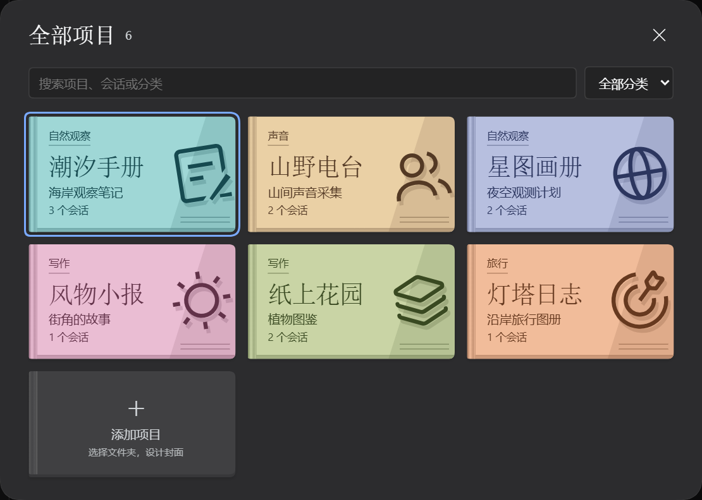
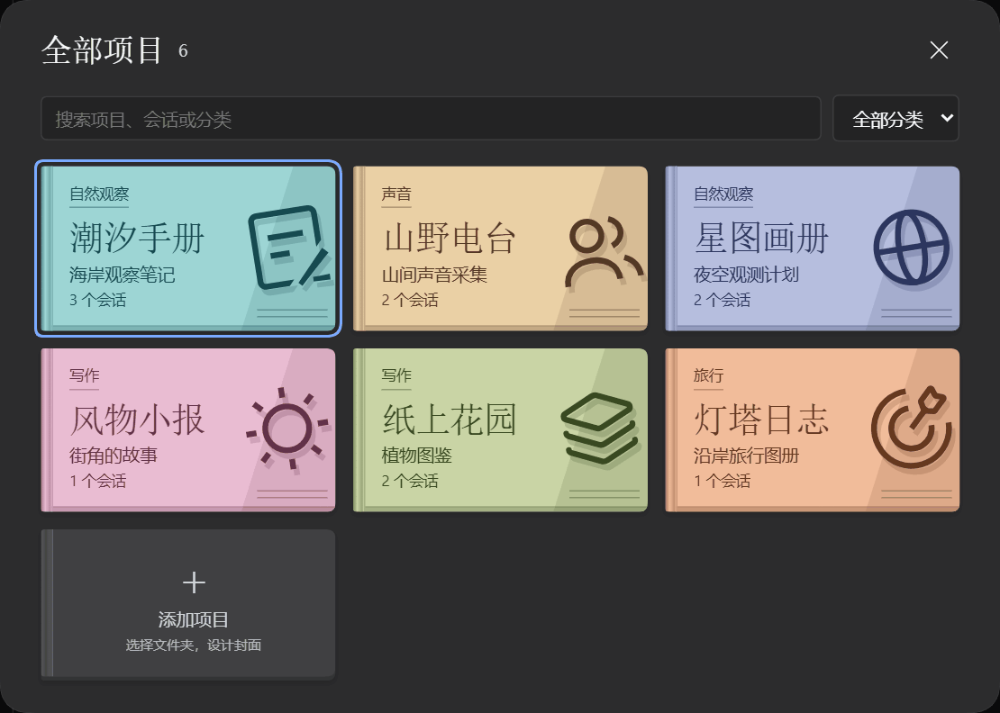
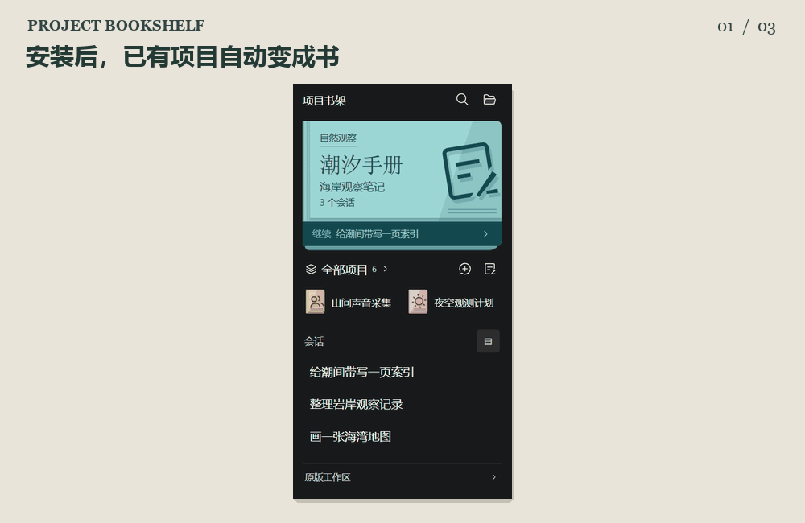
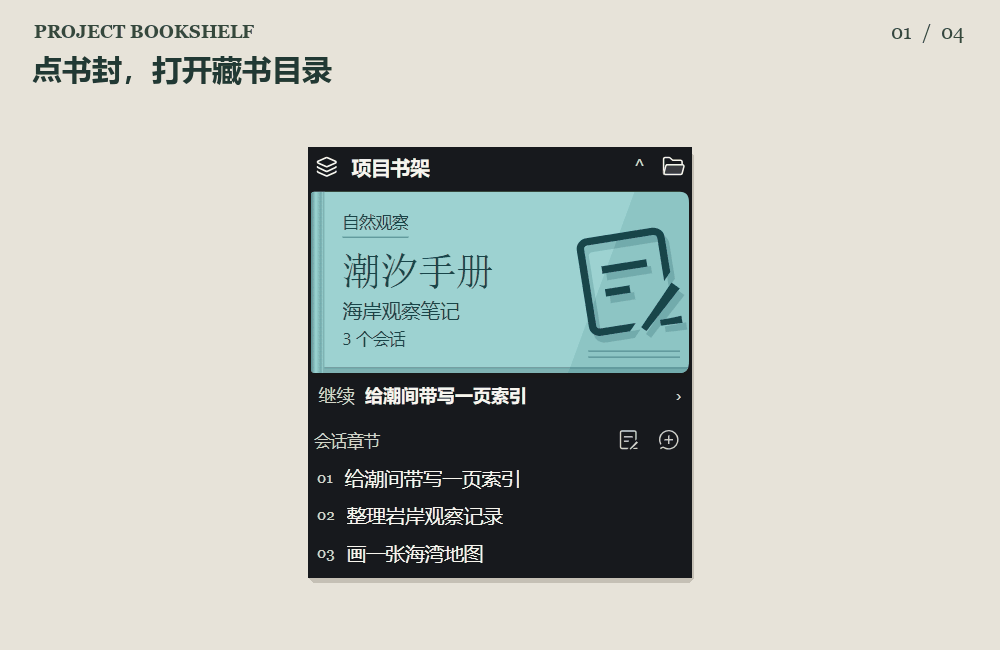
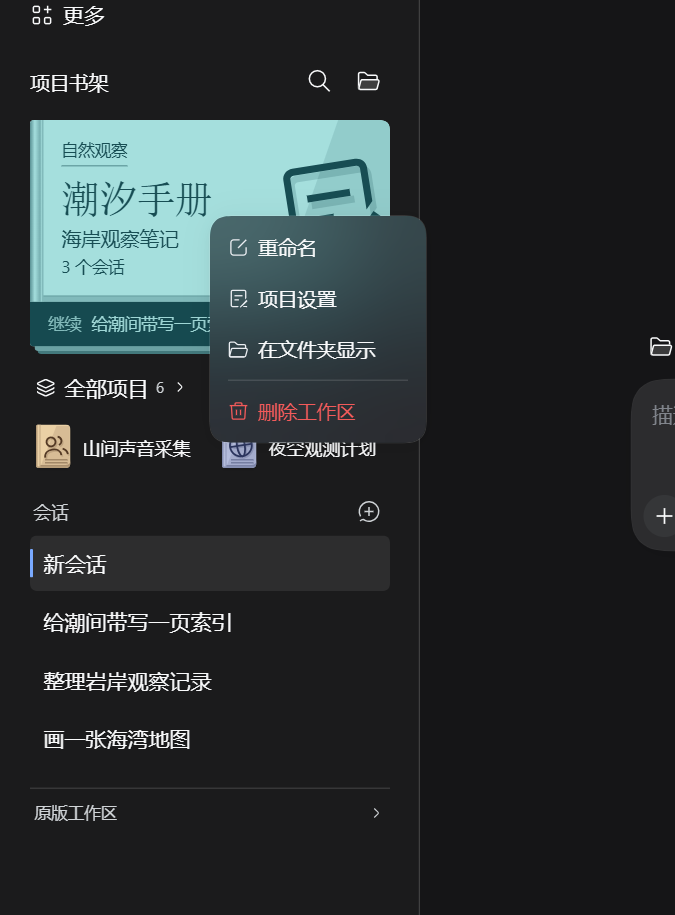

# Project Bookshelf · 项目书架

Recognize a workspace by its cover. Pick a chapter to reopen the conversation where you left off.

[Download v1.1.4](https://github.com/zhishengplus/dsh-project-bookshelf/releases/latest) · [中文](README.md)



## Install

With [Open Plugin Market](https://dshopen.org) enabled, search for **Project Bookshelf** in **Plugins → Discover**. Alternatively, enable **Custom Plugin Index** under experimental plugins and add the author's index:

```text
https://raw.githubusercontent.com/zhishengplus/dsh-project-bookshelf/main/market.json
```

For the Web CLI:

```sh
dsh plugin --profile web add https://github.com/zhishengplus/dsh-project-bookshelf/releases/download/v1.1.4/dsh-project-bookshelf-1.1.4.tgz
```

The complete release is **1.1.4**. Community catalogs may take time to sync; if an older version is offered, use the author index or release tarball above.

## Open the first book

The plugin replaces the workspace browsing area with a bookshelf by default. Your existing projects become books and their conversations become chapters. Select the featured cover to search by folder, alias, category or conversation title. Pick a chapter to reopen it.

The screenshots use fictional projects. Your installed bookshelf reads the project names, conversation titles and messages from your own DSH instance.

Covers, quick switches and the collection show a live spinner and the number of working conversations. Conversation rows update too. Pending confirmations appear separately, and the spinner stops when work ends. System reduced-motion preferences are respected.



The animation simulates status changes with fictional projects. Installed copies read live DSH session status.

The gray **+** book at the end of the collection adds a project folder. DSH opens its system chooser on desktop or its directory browser in remote environments, then shows the cover editor. Projects added through the original workspace picker open the same editor. The collection resizes with the window and scrolls its books while keeping search and close controls visible.

Select **Original workspace** at the bottom to use the native list. Select **Bookshelf mode** beside New session to return. Both views share the same projects, conversations, pins and archives. Your view preference survives reloads.





The pencil opens a live cover proof with 12 paper colors and 12 printed motifs. The folder name stays on the cover even when you give the workspace a display alias. Press **Ctrl / ⌘ + Enter** to save. Cover alerts may highlight pending requests or unread completions.

Display names are saved through DSH. Cover preferences use host workspace metadata when available and client-local storage on other versions. Verified on the official DSH Web 0.2.2-rc.3 release on Windows. All public images show fictional workspaces in an isolated profile.

[MIT License](LICENSE) · [Report an issue](https://github.com/zhishengplus/dsh-project-bookshelf/issues)

New session sits beside the conversation heading. The cover toolbar opens archived conversations, including ungrouped ones. Removing a project requires confirmation and keeps its folder and conversation history.

For maintainers: [listing verification notes](docs/REVIEW.md) document pinned installation sources, implementation references and test scope.

## Project actions, one right-click away



Right-click the main cover, a quick-switch book or a catalog book to rename, edit project settings, reveal its folder or remove its workspace registration. Shift+F10 opens the same menu. Removal asks for confirmation and keeps files and conversation history. Folder availability follows the DSH host.
