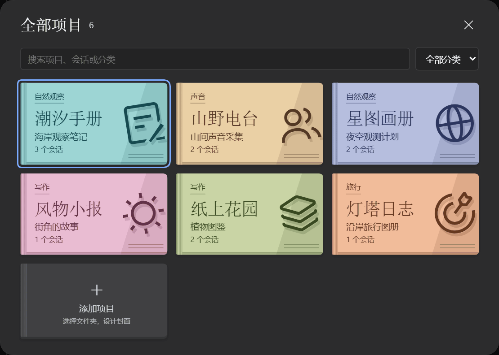
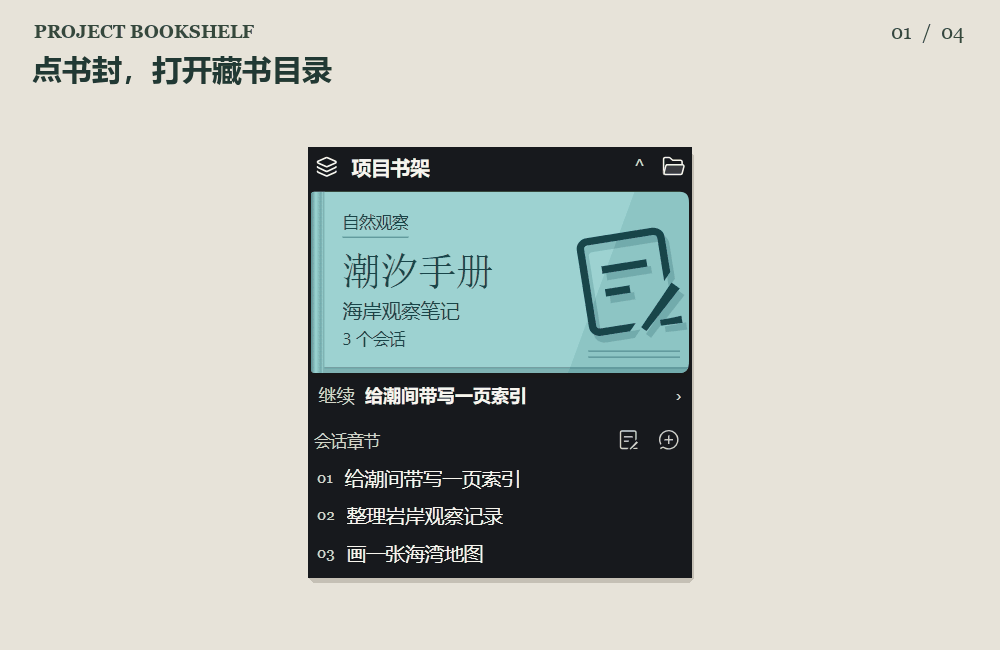
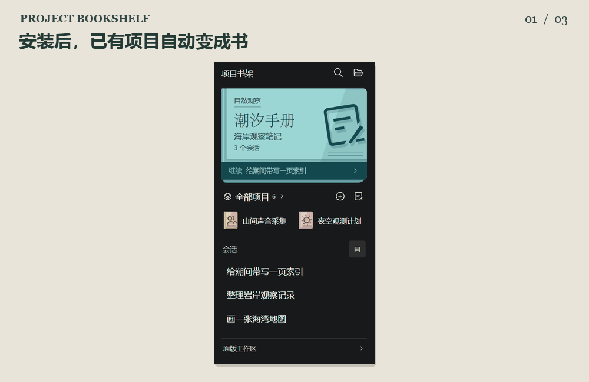

<div align="center">


# 项目书架

**把项目摆上书架，把会话翻成章节。**

[下载 v1.1.3](https://github.com/zhishengplus/dsh-project-bookshelf/releases/download/v1.1.3/dsh-project-bookshelf-1.1.3.tgz)　·　[在 DSH 中安装](#install)　·　[看操作演示](#demo)　·　[English](README.en.md)

</div>


昨天聊到哪儿了？认出「潮汐手册」的青瓷色封面，点一下 **继续**，就能回到「给潮间带写一页索引」那段会话。项目多的时候，点开封面，整架书都在眼前。

**安装后，整个工作区默认变成项目书架。** 你已有的项目自动成为书，文件夹名印在封面上，每段会话成为对应项目里的章节。点书封换项目，点章节继续原来的对话。

配图中的书名是虚构演示。实际安装后，书架上的项目名称、会话标题和对话内容来自你当前使用的 DSH。

书架底部的 **原版工作区** 可以随时切回 DSH 原有列表，再点 **书架模式** 回来。两种视图使用同一批项目、会话、置顶和归档记录，选择的模式会记住。

**一眼看到哪本书还在工作。** 封面、快捷书位和全部项目都会显示转圈与工作中的对话数，会话行同步更新。需要你确认或回复时显示「待处理」，结束后停止转圈。



状态演示使用虚构项目并模拟切换；实际安装读取 DSH 的实时会话状态。

<a id="install"></a>
## 把书架装进 DSH

已启用[开放插件市场](https://dshopen.org)的用户，可以在「插件 → 发现」搜索 **项目书架** 并安装。如果 DSH 提示重启，按界面提示操作。

也可以在「插件 → 实验性插件」启用 **自定义插件索引**，打开「发现 → 添加索引源」，添加作者索引：

```text
https://raw.githubusercontent.com/zhishengplus/dsh-project-bookshelf/main/market.json
```

安装后，展开左侧栏，原工作区位置就会显示 **项目书架** 和你已有的项目。点书封打开全部项目，末尾的灰色 **＋** 书可以添加文件夹。选好文件夹后直接设计封面；书架右上角的文件夹按钮也能进入同一流程。从原版入口添加项目，也会接上封面设置。

<details>
<summary><b>使用 Web 版、命令行或下载的安装包</b></summary>

已安装 DSH CLI 的 Web 用户运行：

```sh
dsh plugin --profile web add https://github.com/zhishengplus/dsh-project-bookshelf/releases/download/v1.1.3/dsh-project-bookshelf-1.1.3.tgz
```

也可以从 [Releases](https://github.com/zhishengplus/dsh-project-bookshelf/releases/latest) 下载 `.tgz`，再将命令里的 URL 换成本地安装包的绝对路径。使用 Desktop **内置命令**时，将 `--profile web` 换成 `--profile desktop`。普通 npm CLI 管理的是 Web 等 profile。

</details>

<a id="demo"></a>
## 从一本书，翻到一段会话



- **认封面。** 文件夹名是书名，显示别名是副标题。相似的项目也能用纸色、印记和分类区分。
- **找项目。** 点当前书封打开目录。输入书名的一部分、别名或分类，或直接用分类下拉框筛选。
- **接着做。** 点「继续」打开最近更新的章节，或点具体章节回到原会话。需要另起话题时，用章节栏旁的「新会话」。
- **接入现有记录。** 未分组会话也有自己的书封。置顶会话排在前面，会话菜单可继续重命名、置顶和归档，归档列表支持恢复。

## 一键回到原版工作区



点击书架底部的 **原版工作区**，原生列表立即出现。点击「新会话」旁的 **书架模式** 返回。切换无需重启，刷新后会沿用你选择的模式。

## 给项目做一张自己的封面


点章节栏的铅笔。**12 种纸色 × 12 枚印记**，改一项就在左侧看到实际书封。名称与分类可直接输入，已有分类会出现在建议里。按 **Ctrl / ⌘ + Enter** 保存。状态和书封提醒收在下面，需要时再展开。

[查看编辑器大图](docs/media/editor.png)　·　[查看侧栏实机图](docs/media/sidebar.png)

## 数据和兼容性

- 书架直接使用 DSH 已有的工作区和会话服务，安装时自动展示已有记录。显示名称通过 DSH 保存，纸色、印记、分类和提醒偏好在支持工作区元数据的宿主中跟随项目保存，其余版本保存在当前客户端。
- 文件夹的实际名称用于封面主标题，显示别名作为副标题。当前空白会话会显示在章节里，已归档记录可以从归档入口查看。子智能体仍通过 DSH 对应会话中的入口访问。
- 展示素材录自 **Windows 上的官方 DSH Web 0.2.2-rc.3**，使用独立配置和六个虚构项目。动图按真实操作步骤剪辑。安装包内已包含构建好的客户端。
- 卸载可在「插件 → 已安装」中操作。CLI 使用 `dsh plugin --profile web remove dsh-project-bookshelf`。卸载书架会移除入口，原有工作区和会话仍由 DSH 管理。

## 开发与反馈

```sh
npm ci
npm test
npm run build
```

欢迎通过 [Issues](https://github.com/zhishengplus/dsh-project-bookshelf/issues) 分享建议。排版问题请附 DSH 版本、窗口宽度和用示例项目复现的截图。

[MIT 许可证](LICENSE) · [DeepSeek Harness](https://github.com/deepseek-ai/deepseek-harness) · [DSH 插件索引指南](https://github.com/deepseek-ai/deepseek-harness/blob/master/docs/user/guide/plugin-market.zh.md)

项目外观设置中的「移除项目」需再次确认，只移除项目登记，保留文件夹和会话历史。「新会话」位于会话栏标题，归档入口位于书封操作行。
