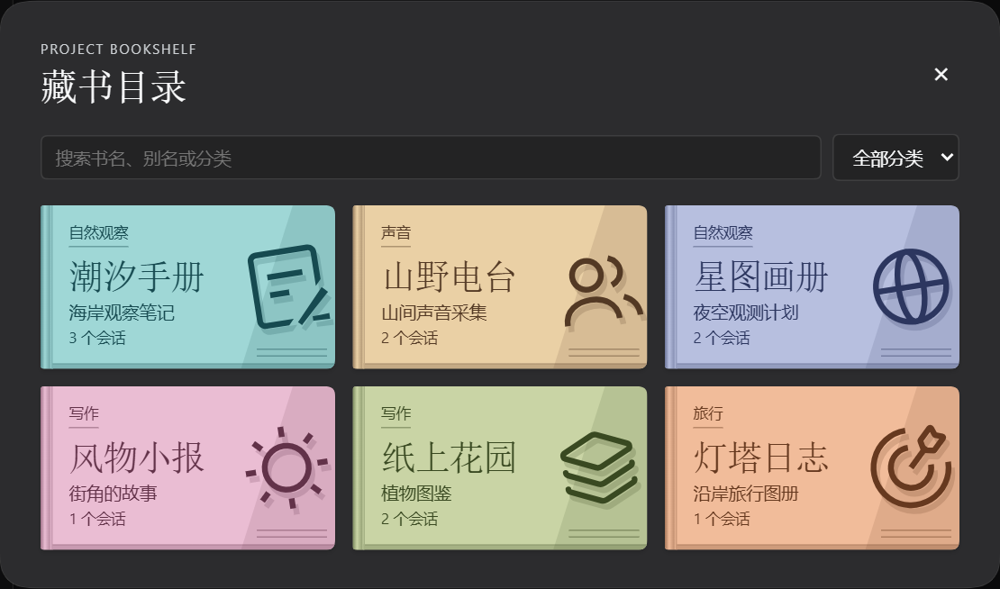
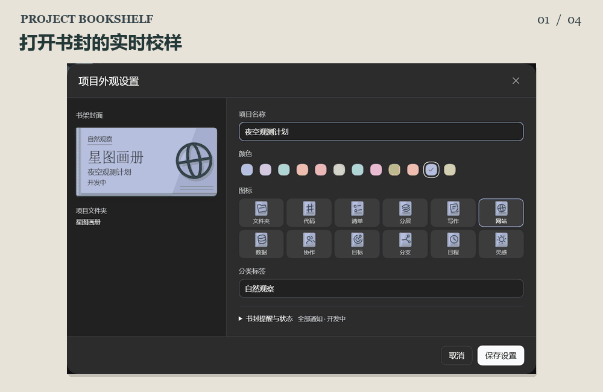

<div align="center">


# 项目书架

**把项目摆上书架，把会话翻成章节。**

[下载 v1.0.0](https://github.com/zhishengplus/dsh-project-bookshelf/releases/download/v1.0.0/dsh-project-bookshelf-1.0.0.tgz)　·　[在 DSH 中安装](#install)　·　[看操作演示](#demo)　·　[English](README.en.md)

</div>



昨天聊到哪儿了？认出「潮汐手册」的青瓷色封面，点一下 **继续**，就能回到「给潮间带写一页索引」那段会话。项目多的时候，点开封面，整架书都在眼前。

**项目书架**是 DeepSeek Harness 的独立社区插件。已有工作区自动成为书，文件夹名直接印在封面上。原生会话列表仍在侧栏，和书架放在一起。

<a id="install"></a>
## 把书架装进 DSH

**桌面用户**可以在插件页完成安装。在「插件 → 实验性插件」启用 **自定义插件索引**，打开「发现 → 添加索引源」，粘贴下面的地址。选择「项目书架」并点 **安装**。如果 DSH 提示重启，按界面提示操作。

```text
https://raw.githubusercontent.com/zhishengplus/dsh-project-bookshelf/main/market.json
```

安装后，展开左侧栏，在「新会话」下面找到 **项目书架**。有项目时会直接显示封面；第一次使用可以点书架标题右侧的文件夹按钮，添加一个已有目录。

<details>
<summary><b>使用 Web 版、命令行或下载的安装包</b></summary>

已安装 DSH CLI 的 Web 用户运行：

```sh
dsh plugin --profile web add https://github.com/zhishengplus/dsh-project-bookshelf/releases/download/v1.0.0/dsh-project-bookshelf-1.0.0.tgz
```

也可以从 [Releases](https://github.com/zhishengplus/dsh-project-bookshelf/releases/latest) 下载 `.tgz`，再将命令里的 URL 换成本地安装包的绝对路径。使用 Desktop **内置命令**时，将 `--profile web` 换成 `--profile desktop`。普通 npm CLI 管理的是 Web 等 profile。

</details>

<a id="demo"></a>
## 从一本书，翻到一段会话


- **认封面。** 文件夹名是书名，显示别名是副标题。相似的项目也能用纸色、印记和分类区分。
- **找项目。** 点当前书封打开目录。输入书名的一部分、别名或分类，或直接用分类下拉框筛选。
- **接着做。** 点「继续」打开最近更新的章节，或点具体章节回到原会话。需要另起话题时，用章节栏旁的「新会话」。
- **省空间。** 长目录先显示前三章，可展开全部。点「项目书架」标题收起整架书，原生工作区仍然可用。

## 给项目做一张自己的封面



点章节栏的铅笔。**12 种纸色 × 12 枚印记**，改一项就在左侧看到实际书封。名称与分类可直接输入，已有分类会出现在建议里。按 **Ctrl / ⌘ + Enter** 保存。状态和书封提醒收在下面，需要时再展开。

[查看编辑器大图](docs/media/editor.png)　·　[查看侧栏实机图](docs/media/sidebar.png)

## 数据和兼容性

- 书架使用 DSH 已有的工作区和会话服务。外观、别名、分类及书封提醒偏好保存在当前客户端的本地存储。换浏览器或清除站点数据后，需要重新设置封面。
- 文件夹的实际名称始终用于主标题；改书封别名不会重命名磁盘上的目录。已归档、空白和子智能体会话不会作为章节列出。
- 展示素材录自 **Windows 上的官方 DSH Web 0.2.2-rc.3**，使用独立配置和六个虚构项目。动图按真实操作步骤剪辑。安装包内已包含构建好的客户端。
- 卸载可在「插件 → 已安装」中操作。CLI 使用 `dsh plugin --profile web remove dsh-project-bookshelf`。卸载书架会移除入口，原有工作区和会话仍由 DSH 管理。

## 开发与反馈

```sh
npm ci
npm test
npm run build
```

欢迎通过 [Issues](https://github.com/zhishengplus/dsh-project-bookshelf/issues) 分享建议。排版问题请附 DSH 版本、窗口宽度和用示例项目复现的截图。

[MIT 许可证](LICENSE) · [DeepSeek Harness](https://github.com/deepseek-ai/deepseek-harness) · [DSH 插件索引指南](https://github.com/deepseek-ai/deepseek-harness/blob/master/docs/user/guide/plugin-market.zh.md)
