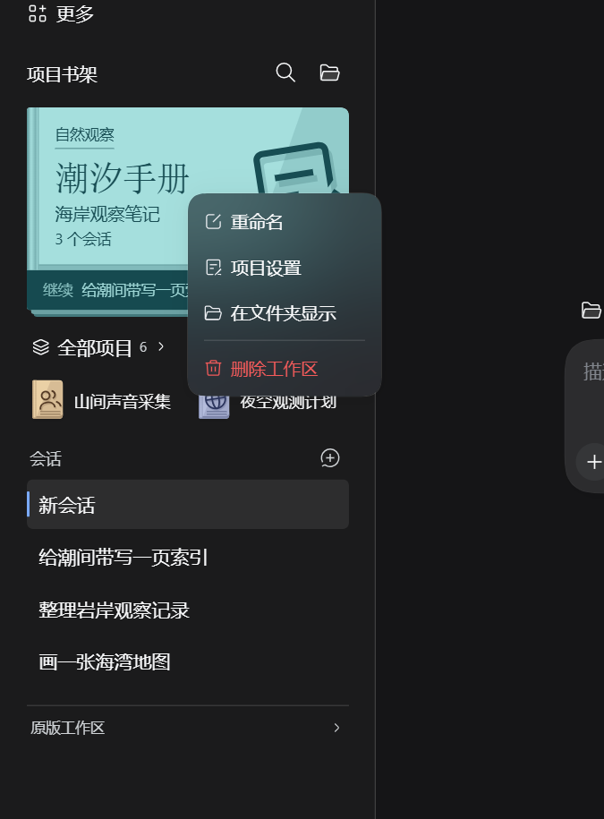

# 项目书架 1.1.4 · 收录核验材料

供社区维护者核对安装来源、功能与验证范围。本页为作者材料，不代表市场审核结论。

## 固定安装来源

| 项目 | 值 |
| --- | --- |
| 包名 / 版本 | `dsh-project-bookshelf` / `1.1.4` |
| 固定源码提交 | [`c0761571a8aa3e3fd8c628598ffb36697bda4748`](https://github.com/zhishengplus/dsh-project-bookshelf/tree/c0761571a8aa3e3fd8c628598ffb36697bda4748) |
| 安装目录 | 仓库根目录 |
| 预构建发行包 | [dsh-project-bookshelf-1.1.4.tgz](https://github.com/zhishengplus/dsh-project-bookshelf/releases/download/v1.1.4/dsh-project-bookshelf-1.1.4.tgz) |
| 大小 / SHA-256 | 28,386 字节 / `d0aa5242e4f81d5f54434a1915f21d335fec5b71799de5c6720b4ded10c7ed18` |
| 宿主声明 | `engines.dsh: >=0.2.2-rc.3 <0.3.0` |
| 许可证 | [MIT](../LICENSE) |

开放插件市场使用上述完整 Git 提交和仓库根目录；发行附件供下载与校验。根目录已含清单、`cordis.patch.yml`、预构建 `client.js` 和 `index.js`，无需用户构建或修改 DSH 安装文件。

## 功能与实现对应

| 能力 | 实现位置 |
| --- | --- |
| 使用每位用户自己的项目、会话 | [src/client.jsx](../src/client.jsx) 读取宿主 `useWorkspaces`、`useSessions`；[src/library.mjs](../src/library.mjs) 投影现有记录，不创建演示书目 |
| 完整书架与原版视图切换 | `sidebar.workspaces`、`ModeButton` 和持久化模式选择，共用宿主数据 |
| 项目右键菜单 | [src/project-menu.mjs](../src/project-menu.mjs) 捕获右键项目；主封面、快捷书位和目录使用同一菜单目标，支持 Shift+F10 |
| 重命名与外观设置 | 独立弹窗调用宿主重命名或元数据服务；原版工作区被替换后也能使用 |
| 文件夹显示 | 复用宿主原生 workspace 菜单的文件管理器动作与可用性；主机不支持时禁用 |
| 会话行为 | 打开、新建、归档恢复通过 `ctx.uiWorkspace`，会话右键沿用宿主菜单 |
| 实时工作与待处理 | `useSessionStatus`、`bookActivity` 与 CSS 转圈；支持减少动画 |
| 添加项目与封面编辑 | [src/project-flow.mjs](../src/project-flow.mjs) 选择支持的桌面或远程流程；新增工作区观察器打开编辑器；系统选择器不是书架挂载的硬性依赖 |
| 项目移除保留数据 | 仅调用 `ctx.workspaces.delete`，两个入口都再次确认；插件不删除文件或会话 |
| 安装清单 | [package.json](../package.json) 声明 `dsh.bundle.patch` 和 `dsh.client`，预构建客户端已纳入源码 |

## 验证记录与边界

实测平台为 **Windows / 官方 DSH Web 0.2.2-rc.3**。macOS 和 Linux 未单独实机验证。

| 范围 | 结果 |
| --- | --- |
| 1.1.4 逻辑测试 | `npm test`：10 项通过，含菜单权限、目标捕获与原生动作委托 |
| 构建 | `npm run build` 成功；包内预构建客户端与发布源码、桌面安装代码一致 |
| 1.1.4 隔离 UI | 主封面、快捷项目、项目目录右键通过；对应项目的重命名持久化、外观设置、Shift+F10、取消移除、确认移除通过；运行时错误 0 |
| 文件夹动作 | 通过宿主实际菜单获取动作，测试模拟 OS 交接并核对请求路径；没有以此声称跨平台真实打开文件管理器 |
| 移除保留数据 | 测试文件内容、会话持久化文件哈希不变；另一个工作区保留 |
| 1.1.3 已有验证 | 会话栏新建按钮、归档切换、未分组归档、编辑器移除确认与取消通过；1.1.4 沿用这些能力 |
| 数据隔离 | 1.1.2 已验证两组已有数据及一个空配置，各自读取自己的内容；1.1.4 沿用同一数据源 |
| 添加与缩放 | 1.1.1 已验证原生/远程选择、三个添加入口和四种窗口；后续沿用布局与流程 |
| 动态状态 | 1.1.2 隔离模拟工作、等待、停止与减少动画；1.1.4 沿用 |

固定 Git 安装和公开附件的回下载校验结果，在对应社区更新请求中提供。

## 隐私、权限与安装行为

- 发行包仅 13 个文件，没有个人项目、会话数据库、配置凭据或演示种子。
- 作者侧以 179 项私人标识及凭据/路径模式扫描源码和安装包，命中 0；私人清单、诊断和真实资料不公开。
- 不新增 HTTP 服务端接口或安装期执行脚本；服务端入口为空 `apply()`。
- 重命名和移除菜单按被点击项目的宿主权限显示；请求仍由宿主验证。文件夹动作沿用宿主能力。
- 外观在有元数据服务的宿主中随项目保存；其他版本使用当前客户端存储。包没有官方 DSH/React 运行时依赖，UI 由宿主提供。
- [screenshots.json](../screenshots.json) 声明 6 张仓库内截图。公开图片、动图全为虚构项目；状态动图明确标注模拟。

## 1.1.4 项目右键菜单

旧版已有的会话与归档入口、编辑器移除确认仍保留：

[发行页](https://github.com/zhishengplus/dsh-project-bookshelf/releases/tag/v1.1.4) · [操作演示](../README.md#demo) · [更新记录](../CHANGELOG.md)
