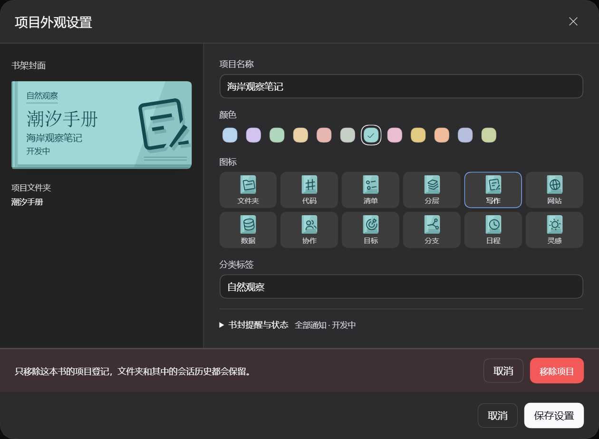

# 项目书架 1.1.3 · 收录核验材料

此页供社区维护者核对安装来源、实现与验证范围，是作者侧提供的材料，不代表社区审核结论。

## 固定安装来源

| 项目 | 值 |
| --- | --- |
| 包名 / 版本 | `dsh-project-bookshelf` / `1.1.3` |
| 许可证 | MIT，见 [LICENSE](../LICENSE) |
| 固定源码提交 | [`22168544a656059aea0056330d28fadf985306b1`](https://github.com/zhishengplus/dsh-project-bookshelf/tree/22168544a656059aea0056330d28fadf985306b1) |
| 安装子目录 | 仓库根目录 |
| 预构建发行包 | [dsh-project-bookshelf-1.1.3.tgz](https://github.com/zhishengplus/dsh-project-bookshelf/releases/download/v1.1.3/dsh-project-bookshelf-1.1.3.tgz) |
| 发行包大小 / SHA-256 | 26,436 字节 / `4972eb9077e2a4f24857a6b8e09397acc1e50c1c34e466f92fd3705de2cd692b` |
| 宿主声明 | `engines.dsh: >=0.2.2-rc.3 <0.3.0` |

开放插件市场的 Git 来源可直接使用上述完整提交和根目录，不需要将 Release 附件作为市场安装来源。根目录已有 `package.json`、`cordis.patch.yml`、预构建 `client.js` 和入口 `index.js`，无需修改 DSH 安装文件或 `app.asar`。

## 声明与实现对应

| 描述中的能力 | 实现位置与核对点 |
| --- | --- |
| 接入使用者自己的项目和会话 | [src/client.jsx](../src/client.jsx) 的 `Shelf` 读取宿主 `useWorkspaces`、`useSessions`；[src/library.mjs](../src/library.mjs) 只投影这些记录，不创建演示书目 |
| 完整书架与原版视图切换 | `sidebar.workspaces` 插槽、`ModeButton` 和持久化模式选择；两种视图共用宿主数据 |
| 原生会话行为 | 打开、新建、归档恢复通过 `ctx.uiWorkspace`，右键菜单沿用宿主会话菜单 |
| 实时工作状态 | `useSessionStatus`、`bookActivity` 与 CSS 转圈；待处理单独计数，停止后清除工作提示，支持减少动画 |
| 文件夹选择与新项目外观 | [src/project-flow.mjs](../src/project-flow.mjs) 区分桌面原生选择与远程目录浏览；新增工作区观察器打开外观设置 |
| 封面保存 | 有宿主元数据服务时保存至工作区；其他版本通过宿主重命名并把外观保存在当前客户端 localStorage |
| 项目移除保留数据 | `Shelf.remove` 仅调用 `ctx.workspaces.delete`；[src/project-appearance.tsx](../src/project-appearance.tsx) 再次确认后执行，不在插件中删除文件或会话 |
| 安装清单 | [package.json](../package.json) 声明 `dsh.bundle.patch` 和 `dsh.client`；[cordis.patch.yml](../cordis.patch.yml) 注册唯一插件入口 |

## 验证记录摘要

测试环境为 Windows、官方 DSH Web 0.2.2-rc.3。macOS 与 Linux 没有单独实机验证，请勿把宿主版本声明理解为这些平台均已测试。

| 范围 | 结果 |
| --- | --- |
| 1.1.3 逻辑测试 | `npm test`，9 项通过 |
| 1.1.3 构建 | `npm run build` 成功，发布前重建产物一致 |
| 1.1.3 隔离 UI 实测 | 新会话按钮位置、归档图标切换、取消移除、确认移除、未分组归档入口通过；浏览器运行时错误 0 |
| 移除数据保留 | 隔离项目中的测试文件内容不变，会话持久化文件哈希不变；另一个项目仍存在 |
| 多用户与首次启动 | 1.1.2 已验证两组独立已有数据和一个空配置，显示各自数据，没有注入演示数据；1.1.3 未改变此读取通路 |
| 目录选择与窗口 | 1.1.1 已验证桌面选择、取消、远程浏览、三个添加入口和四种窗口尺寸；后续版本沿用该实现 |
| 动态状态 | 1.1.2 在隔离配置中模拟工作、等待、停止与减少动画，确认封面、快捷书位、目录及会话行更新；1.1.3 未改变此通路 |
| 固定 Git 提交安装 | 1.1.3 在全新隔离配置安装成功，清单版本及预构建客户端与发行包一致 |
| 发行附件 | 从 GitHub 重新下载，SHA-256 与核验包一致 |

## 数据、权限和安装行为

- 发行包只有 13 个文件，包含清单、入口、构建客户端、图标、许可证、说明和翻译；不包含项目目录、会话数据库、用户配置、API Key 或演示种子。
- 作者侧使用 179 项本地私人标识及凭据/路径模式核验公开源码和发行包，命中 0。具体私人标识和原始诊断不公开。
- 插件不注册额外 HTTP 服务端接口，不添加安装期执行脚本。服务端入口为空 `apply()`；项目和会话操作走 DSH 原有服务及权限判断。
- 项目删除控件按宿主 `workspace/delete` 权限显示；错误由界面呈现，不绕过宿主权限。
- `package.json` 没有运行时依赖列表，官方 React 与 UI 基础组件由宿主提供，开发依赖仅用于构建。
- [screenshots.json](../screenshots.json) 的三张图片均在仓库内。所有公开书目和会话名是虚构演示；状态动图的切换为模拟，实际安装使用宿主实时状态。

## 复核入口

```sh
dsh plugin --profile web add https://github.com/zhishengplus/dsh-project-bookshelf/releases/download/v1.1.3/dsh-project-bookshelf-1.1.3.tgz
```

安装后应看到该配置已有的项目，点书封可打开项目目录。外观设置中的移除动作会再次确认；也可以在测试配置先创建一个普通文件和两段会话，再验证移除登记后这些内容仍保留。

[操作演示](../README.md#demo) · [更新记录](../CHANGELOG.md) · [问题反馈](https://github.com/zhishengplus/dsh-project-bookshelf/issues)

## 1.1.3 实际界面（虚构项目）

新会话位于会话标题右侧，归档入口位于书封操作行。


移除项目须再次确认，界面明确说明文件夹和会话保留；截图仅展示确认步骤，没有操作真实项目。


